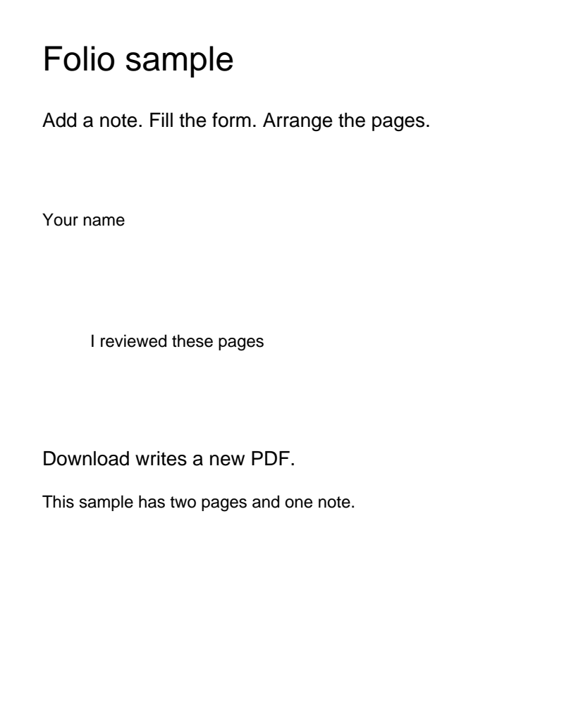
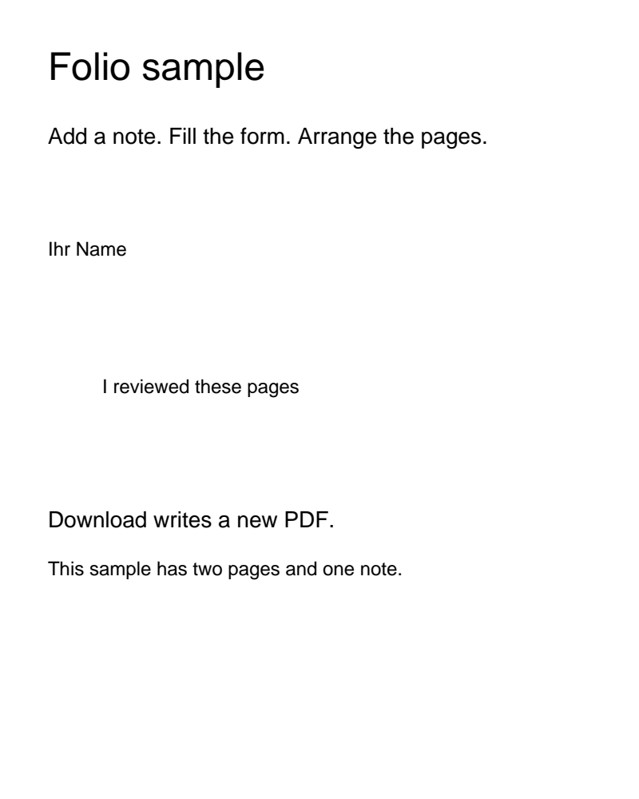
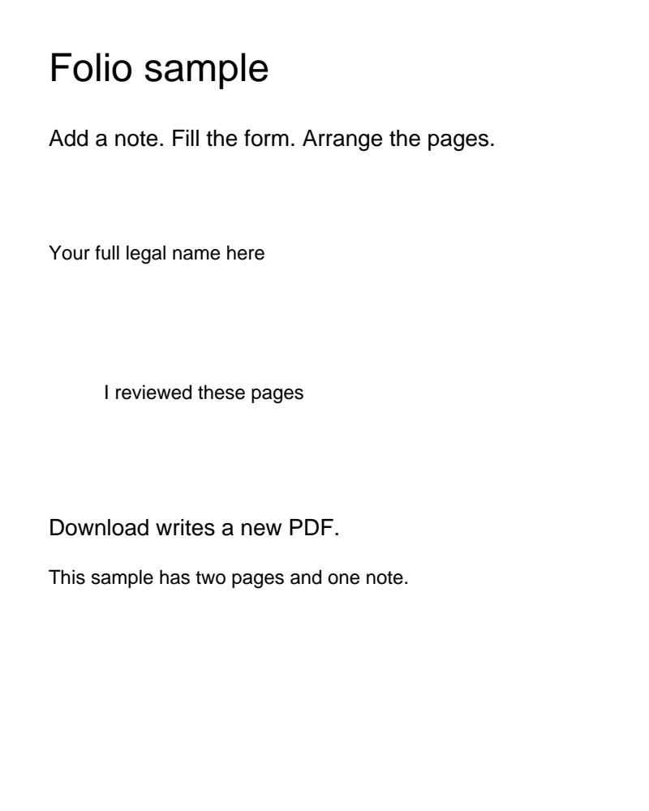

# Folio text-edit proof

This record proves that a Wording Edit is possible with the wasm Folio already
ships, and records the two failure modes that the verified-byte gate exists to
catch. It is a spike, not production code.

## Environment

- `@embedpdf/engine-runtime@3.0.0-next.18` with `@embedpdf/engine-runtime-wasm32`
  (`embedpdf.wasm`, 7,703,156 bytes, 1,031 exported functions), run with
  `createPdfRuntime({ wasmUrl, prefer: "wasm" })` on Node 26.12.1.
- Fixtures: `apps/web/src/features/folio/fixtures/sample.pdf` and
  `text-10.pdf`, rendered at 2x with `FPDF_RenderPageBitmap`.

## Sequence

```js
fn.FPDF_InitLibrary();                                   // required; without it FPDF_LoadPage traps
const doc = fn.FPDF_LoadMemDocument64(pointer, length, "");
const page = fn.FPDF_LoadPage(doc, 0);
const tp = fn.FPDFText_LoadPage(page);
// find the object: FPDFPage_CountObjects / FPDFPage_GetObject / FPDFPageObj_GetType === 1
// read it: FPDFTextObj_GetText(obj, tp, null, 0) -> byte size, then the buffer (UTF-16LE)
fn.FPDFText_SetText(obj, utf16Pointer);
fn.FPDFPage_GenerateContent(page);                       // required after SetText
// save: FPDF_SaveAsCopy(doc, fileWriteStruct, 2) with cb.register("iiii", writeBlock)
```

Notes for the worker:

- `EPDF_LoadMemBaseDocument64` returns an EPDF handle, not an `FPDF_DOCUMENT`.
  `FPDF_LoadPage` on it traps. Use `FPDF_LoadMemDocument64` for a text session.
- `mem.alloc` returns a `BigInt`. An `FPDF_FILEWRITE` struct is 8 bytes: version
  `1` at offset 0, the callback pointer at offset 4.
- Text crosses the boundary as UTF-16LE with a NUL terminator.
- `FPDFFont_GetBaseFontName` returns bytes, not UTF-16. Reading it as UTF-16
  produces garbage.

## Result: success

`sample.pdf` page 1, object `"Your name"` (Helvetica) → `"Ihr Name"`.
`SetText` and `GenerateContent` return `true`, the file grows from 3,421 to
5,307 bytes, and the reopened file renders and extracts the new string.

| before | after |
| --- | --- |
|  |  |

## Result: missing glyphs are silent

The same object → `"Ваше имя"`. Both calls return `true`, the saved file is
valid, and the page renders `ÿÿÿÿ ÿÿÿ`. Extraction returns the same `ÿ`
characters, so a post-save extract-and-compare check catches this before the
file reaches the user.


## Result: no reflow

The same object → `"Your full legal name here"`. The string overwrites nothing
and pushes right into free space. In a column it would collide; nothing in the
engine prevents it.



## Result: the object is the unit

`text-10.pdf` page 1 holds its whole sentence in one text object. Replacing `a`
rewrote the entire line. A word inside a PDF Text Object is not addressable.
